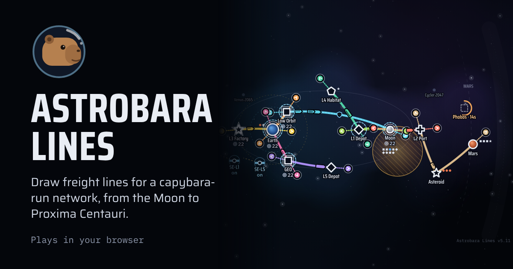
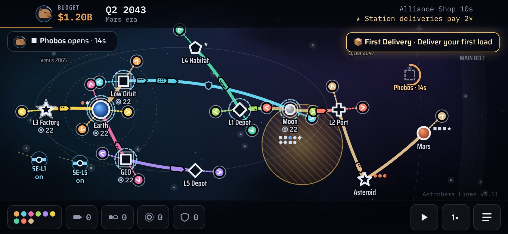
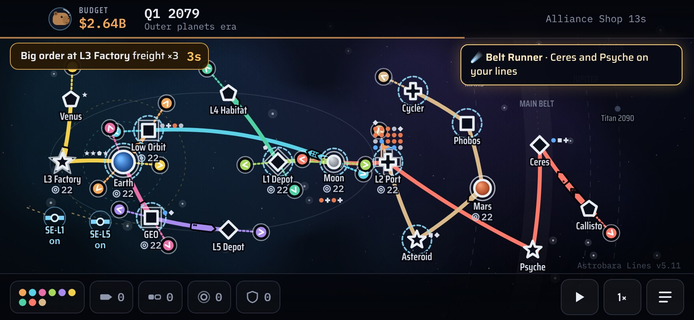
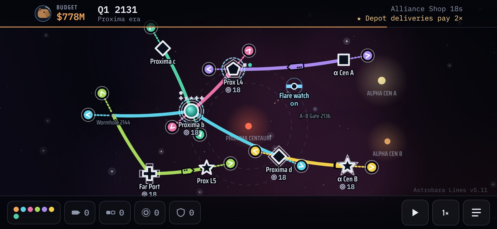
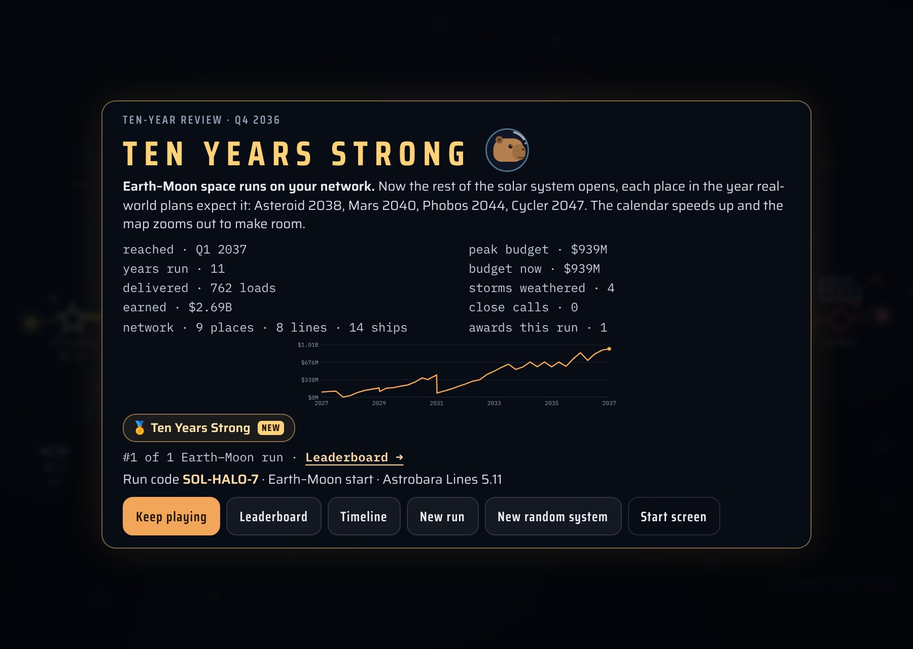
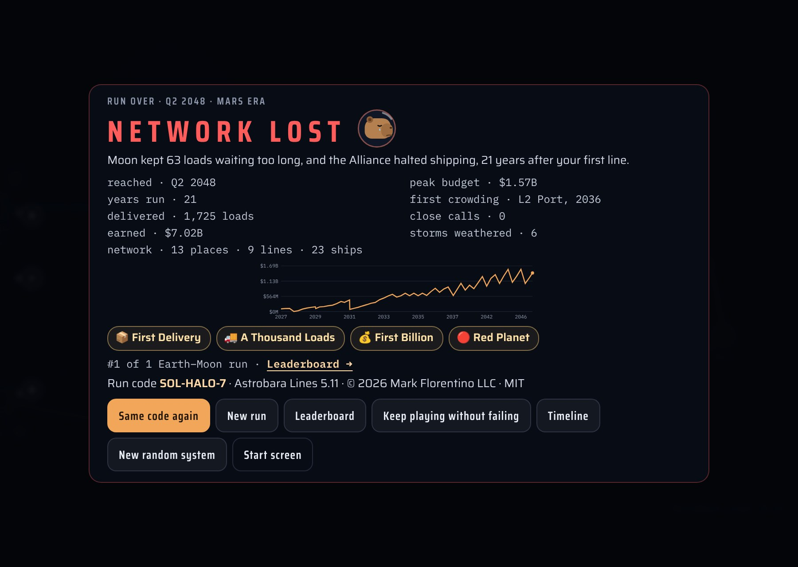
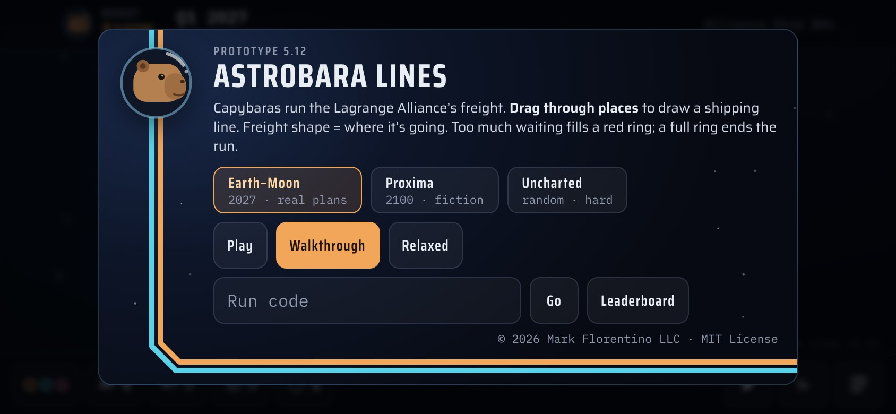
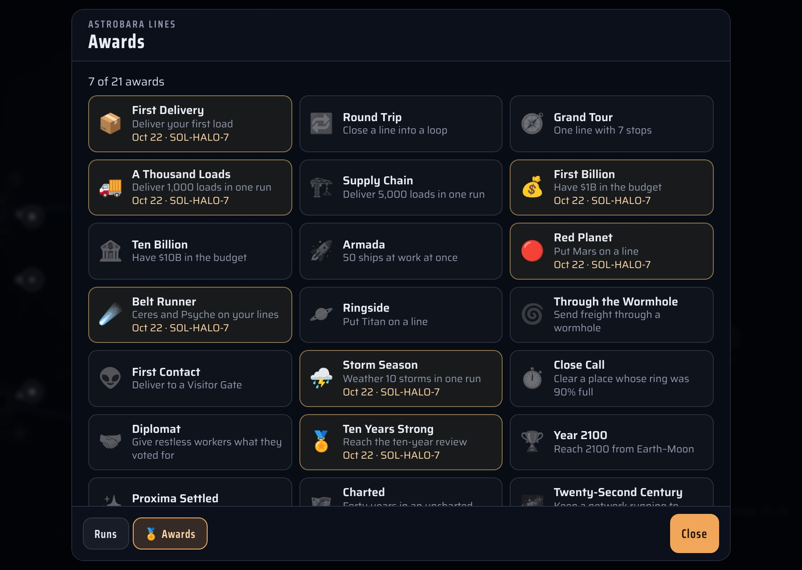

# Astrobara Lines

### [▶ Play Astrobara Lines](https://sockmonke-rgb.github.io/astrobara-lines/)

A capybara-run freight network in the style of Mini Metro. Start in Earth–Moon space in 2027 and build shipping lines outward. Places open in the years real-world plans expect them, out past Saturn, then through a wormhole to Proxima Centauri, and from 2200 on through a second one to an uncharted star system.

It's one HTML file with no build step and no dependencies. It plays in a phone or desktop browser.

**On your home screen:** on iPhone or iPad, open the game in Safari, tap Share, then **Add to Home Screen**. In Chrome on Android, use the ⋮ menu and **Add to Home screen**. The game gets its own capybara icon and opens full screen. iOS keeps a home-screen app's saves separate from Safari's, so a run started in one won't show up in the other.

## How to play

- **Draw lines:** drag through places to draw a shipping line. A load's shape is the kind of place it's headed for.
- **Don't let freight pile up:** too much waiting at one place fills a red ring, and a full ring ends the run.
- **Extend or trim:** drag the round knob at a line's end to extend it, or drag the knob back along the line to cut stops off. Dragging from a place always starts a new line.
- **Lines:** tap a line to add ships and cargo pods, or to remove it.
- **Places:** tap a place to build a depot or fast dock, protect it with a shield, repair storm damage, or open talks.
- **Alliance Shop:** every period the Lagrange Alliance sends a ship, sells upgrades and offers one free pick. You can skip the pick and bank interest instead.
- **Storms, debris and surges:** shields keep lines running through them. Late in a run, places that are kept waiting grow restless and may declare independence until you negotiate.
- **Normal and Hard:** chosen on the start screen. Hard has the full friction below; Normal caps upkeep at 35%, drops the fuel slowdown, has rarer breakdowns and keeps the 30s red ring.
- **Friction:** ships at work cost upkeep at each shop visit, a share of what the network earned that grows with the fleet (up to 60%). A place loads three ships at once and the rest queue. Long lines with no ◆ fuel depot run slower. Late in a run ships break down now and then, rushes and strikes swing demand, and the red ring fills faster.
- **Stuck freight:** if loads at a place can't board anything, a note says where and why.

## Starts

- **Earth–Moon (2027):** each place opens in the year real-world plans expect it. The timeline notes what's real and what's speculative. A wormhole opens past Saturn in 2100 to Proxima Centauri, and in 2200 a second, the Rift, opens from Proxima to a random uncharted system. Each brings three more lines, up to 15.
- **Proxima (2100):** science fiction.
- **Uncharted:** a random star system. It's harder, and not everything in it is built by us.

Every run has a code like `SOL-HALO-417`. Type it on the start screen to play the same map again.

## Controls

- **Touch:** drag to draw, drag empty space to pan, pinch to zoom. The game also plays with the phone held upright, turned on its side.
- **Desktop:**
  - Mouse: the same as touch, with the scroll wheel to zoom. Rest the mouse on a button, a place, a line or a sensor to see what it is.
  - <kbd>Space</kbd> plays or pauses.
  - <kbd>1</kbd> <kbd>2</kbd> <kbd>3</kbd> <kbd>5</kbd> set the speed (5× asks first).
  - <kbd>Esc</kbd> closes the bar along the bottom.
- **Pauses:** by default the game pauses when a new place opens or a place wants to talk. Turn this off in the speed menu.

## Saving, leaderboard, awards

- **Saving:** runs save in the browser's local storage. Inside the Claude app they also save to the app's cloud storage, and the leaderboard is shared with everyone the game is shared with. The standalone page keeps everything local.
- **Leaderboard:** one row per run code, ranked by the furthest year reached.
- **Awards:** 22 to earn, from your first delivery to running lines in three star systems at once.

## Screenshots

<table>
  <tr>
    <td width="50%"> Out to Jupiter, 2079</td>
    <td width="50%"> The Proxima start, 2131</td>
  </tr>
  <tr>
    <td> The ten-year review</td>
    <td> When a run ends</td>
  </tr>
  <tr>
    <td> The start screen</td>
    <td> Awards</td>
  </tr>
</table>

## Reporting a problem

Open ≡ → **Diag** → **Copy diagnostics**, or tap **Copy diag** on the Network Lost card. This copies a short text report covering version, device, frame rate, the run's state, the recent log and any errors. **Copy save too** adds the run itself, compressed, so the exact moment can be loaded and looked at.

## Credits

© 2026 Mark Florentino LLC, under the [MIT License](LICENSE). Set in the world of [Astrobara](https://github.com/sockmonke-rgb/astrobara).
